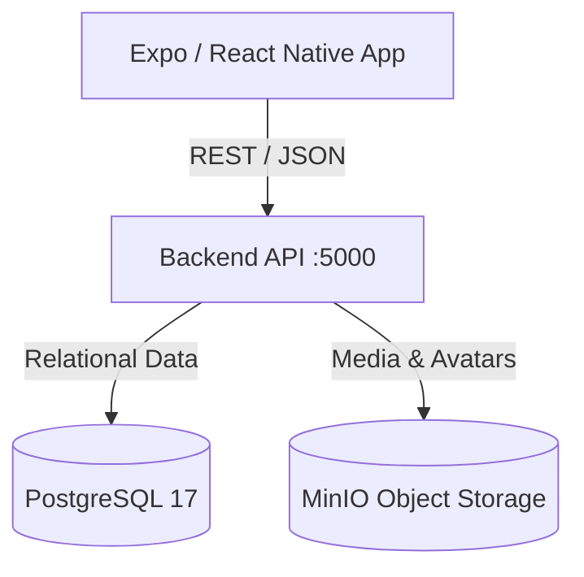

# Architecture

## Overview
Riyadah Elite ("Game Testing And Tournament") is designed as a platform connecting game developers and players/gamers. The frontend is a cross-platform mobile app built on React Native & Expo SDK 58 using file-based routing.

## Architectural Patterns
1. **File-Based Routing**:
   - `src/app/` serves as the routing root using Expo Router.
   - Root layout (`src/app/_layout.tsx`) initializes theme providers, safe area wrappers, and stack navigation.
   - Screen implementations reside inside `src/app/` (e.g., `index.tsx`).

2. **Layered Client Architecture**:
   - **Views / Routes (`src/app/`)**: Presentational screens and navigation layouts.
   - **Components (`src/components/`)**: Reusable UI components (buttons, theme-aware views and texts).
   - **Services (`src/services/`)**: API abstraction modules (e.g. `auth.ts`) handling request payloads and type mappings.
   - **Network Layer (`src/lib/api-client.ts`)**: Generic fetch wrapper with typed responses, headers, and error handling.
   - **Config & Constants (`src/constants/`)**: Environment routing and public configuration tokens.
   - **Hooks (`src/hooks/`)**: Reusable lifecycle, color scheme, and UI interaction logic.
